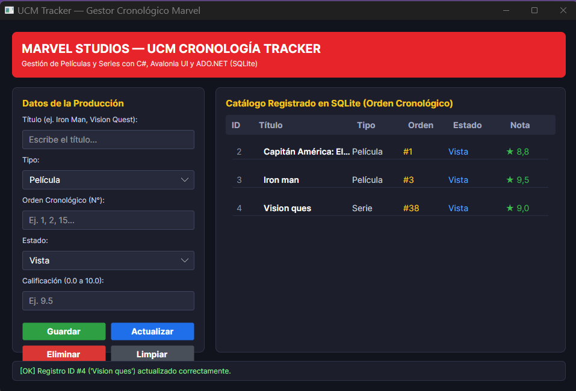

# UCM Tracker — Gestor Cronológico de Películas y Series Marvel

## 6.1. Información general
- **Nombre del proyecto:** UCM Tracker (Gestor Cronológico Marvel)
- **Estudiante:** Saray Natalia Duarte Florez
- **Modalidad:** Virtual
- **Asignatura:** Programacion en C# con .NET (Parcial Final)
- **Institucion:** Corporación Universitaria Americana
- **Descripción del software:** Aplicación de escritorio desarrollada en C# (.NET 8) con interfaz grafica en Avalonia UI 11 y almacenamiento persistente local mediante ADO.NET y SQLite. Permite administrar un catalogo personalizado de peliculas, series y especiales del Universo Cinematográfico de Marvel (UCM) organizados por su orden cronologico.
- **Problema o necesidad que resuelve:** Facilita llevar un control estructurado y persistente del orden cronologico de visualizacion de las producciones de Marvel, evitando perder el seguimiento de capitulos o peliculas vistas, pendientes y sus respectivas calificaciones.
- **Objetivo principal de la aplicacion:** Implementar un sistema CRUD completo (Crear, Consultar, Actualizar y Eliminar) integrando Programacion Orientada a Objetos (POO), interfaz grafica XAML en Avalonia UI y consultas SQL parametrizadas con ADO.NET sobre SQLite.

---

## 6.2. Funcionalidades
- **Registro (Create):** Permite agregar nuevas producciones Marvel indicando título, tipo (Película, Serie o Especial), número en el orden cronológico, estado de visualización (Vista, En progreso o Pendiente) y calificación de 0.0 a 10.0.
- **Consulta (Read):** Lista automáticamente todos los registros almacenados en SQLite ordenados de forma ascendente por su número cronológico (`ORDER BY OrdenCronologico ASC`).
- **Actualización (Update):** Al seleccionar cualquier fila del catálogo, carga sus datos en el formulario para modificar su estado, nota o título y actualizar el registro en la base de datos.
- **Eliminación (Delete):** Permite eliminar permanentemente un registro seleccionado de la base de datos SQLite.
- **Validaciones de entrada:** Verifica que el título no esté vacío, que el orden cronológico sea un entero positivo mayor a 0 y que la calificación esté dentro del rango válido (`0.0` a `10.0`), informando cualquier error al usuario en pantalla.

---

## 6.3. Tecnologías utilizadas
- **Versión de .NET:** .NET 8.0 SDK
- **Lenguaje de programacion:** C# 12
- **Interfaz grafica:** Avalonia UI 11 (`.axaml`)
- **Acceso a datos:** ADO.NET (`Microsoft.Data.Sqlite` versión `8.0.11`)
- **Motor de base de datos:** SQLite 3 (archivo local `ucm_tracker.db`)
- **Entorno de desarrollo:** Visual Studio Code y Git / GitHub

---

## 6.4. Estructura del proyecto

```text
UcmTrackerApp/
├── Data/
│   └── MarvelRepository.cs      # Clase de acceso a datos con ADO.NET y SQLite (CRUD)
├── Models/
│   └── ProduccionMarvel.cs      # Clase modelo que representa la entidad del dominio
├── evidencias/
│   ├── registro.png             # Captura de prueba 1: Registro
│   ├── consulta.png             # Captura de prueba 2: Consulta
│   ├── actualizacion.png        # Captura de prueba 3: Actualizacion
│   ├── eliminacion.png          # Captura de prueba 4: Eliminacion
│   ├── validacion.png           # Captura de prueba 5: Validacion
│   └── persistencia.png         # Captura de prueba 6: Persistencia
├── App.axaml                    # Configuración global de estilos y temas de Avalonia
├── App.axaml.cs                 # Ciclo de vida de la aplicacion Avalonia
├── MainWindow.axaml             # Diseño visual de la ventana principal en XAML
├── MainWindow.axaml.cs          # Controlador de eventos de UI, validaciones e integración
├── Program.cs                   # Punto de entrada principal de la aplicacion
├── UcmTrackerApp.csproj         # Archivo de proyecto .NET 8 y dependencias NuGet
└── README.md                    # Documentación técnica del proyecto
```

### Clases principales y aplicación de POO
1. **`ProduccionMarvel` (`Models/ProduccionMarvel.cs`):** Encapsula los atributos de cada produccion (`Id`, `Titulo`, `Tipo`, `OrdenCronologico`, `Estado`, `Calificacion`) mediante propiedades publicas y sobrecarga de constructores (constructor vacío y constructor parametrizado).
2. **`MarvelRepository` (`Data/MarvelRepository.cs`):** Aplica el principio de responsabilidad única separando completamente la lógica SQL de la interfaz gráfica. Encapsula la cadena de conexion (`private readonly string _connectionString`) y expone métodos publicos para las operaciones `Agregar`, `ObtenerTodas`, `Actualizar` y `Eliminar`.
3. **`MainWindow` (`MainWindow.axaml.cs`):** Gestiona la interaccion con el usuario, captura los eventos `Click` y `SelectionChanged`, valida los datos ingresados y delega las operaciones de persistencia a una instancia de `MarvelRepository`.

---

## 6.5. Instalación de dependencias
1. Verificar que esté instalado el **SDK de .NET 8.0** ejecutando `dotnet --version`.
2. Clonar este repositorio desde GitHub:
   ```bash
   git clone [https://github.com/saryduarte/ucm-tracker-avalonia.git](https://github.com/saryduarte/ucm-tracker-avalonia.git)
   ```
3. Ingresar a la carpeta del proyecto:
   ```bash
   cd ucm-tracker-avalonia
   ```
4. Restaurar los paquetes NuGet necesarios (incluye `Avalonia` y `Microsoft.Data.Sqlite` 8.0.11):
   ```bash
   dotnet restore
   ```
*(No requiere configuración de servidores externos ni scripts SQL manuales, ya que la base de datos SQLite se genera automaticamente).*

---

## 6.6. Ejecución del programa
1. Compilar el proyecto para verificar que no existan errores:
   ```bash
   dotnet build
   ```
2. Ejecutar la aplicación de escritorio:
   ```bash
   dotnet run
   ```
Al iniciar, se abrirá la ventana principal **UCM Tracker — Gestor Cronologico Marvel** lista para registrar, consultar, editar o eliminar producciones.

---

## 6.7. Base de datos
- **Informacion almacenada:** Registra producciones audiovisuales de Marvel en la tabla `ProduccionesMarvel` con las columnas:
  - `Id` (`INTEGER PRIMARY KEY AUTOINCREMENT`): Identificador unico de cada registro.
  - `Titulo` (`TEXT NOT NULL`): Nombre de la pelicula, serie o especial.
  - `Tipo` (`TEXT NOT NULL`): Clasificacion del formato (`Película`, `Serie`, `Especial`).
  - `OrdenCronologico` (`INTEGER NOT NULL`): Posicion dentro de la linea temporal del UCM.
  - `Estado` (`TEXT NOT NULL`): Seguimiento del usuario (`Vista`, `En progreso`, `Pendiente`).
  - `Calificacion` (`REAL NOT NULL`): Puntuacion numerica asignada por el usuario (`0.0` a `10.0`).
- **Conexion con SQLite:** Se establece mediante `SqliteConnection` usando la cadena `"Data Source=ucm_tracker.db"` dentro de bloques `using` para garantizar el cierre de la conexion y liberacion de memoria tras cada operacion.
- **Operaciones CRUD:** Se ejecutan mediante `SqliteCommand` utilizando parámetros (`@Titulo`, `@Tipo`, `@OrdenCronologico`, `@Estado`, `@Calificacion`, `@Id`) para prevenir inyección SQL, empleando `ExecuteNonQuery()` para inserciones/actualizaciones/eliminaciones y `SqliteDataReader` (`ExecuteReader()`) para la lectura de registros.
- **Creacion automatica:** Al instanciar `MarvelRepository`, el metodo privado `InicializarBaseDeDatos()` crea el archivo `ucm_tracker.db` y ejecuta `CREATE TABLE IF NOT EXISTS ProduccionesMarvel (...)` automaticamente si aun no existen.

---

## 6.8. Evidencias de funcionamiento

### 1. Prueba de Registro (Create)
Se ingresó la película *Capitan America: El primer vengador* (Orden #1, Vista, Nota 8.8) y se presiono **Guardar**. El sistema confirmo la inserción en SQLite y la mostró en la tabla.


### 2. Prueba de Consulta (Read)
Se registraron multiples producciones (*Capitán América*, *Iron Man* y *Vision Quest*) y la aplicación consultó la base de datos mostrándolas ordenadas automaticamente por su número cronológico (`#1`, `#3`, `#38`).


### 3. Prueba de Actualización (Update)
Se selecciono el registro ID #4 (*Vision Quest*), se modifico su estado de `Pendiente` a `Vista` y se presionó **Actualizar**, reflejando el cambio inmediatamente en la interfaz y en SQLite.


### 4. Prueba de Eliminación (Delete)
Se selecciono el registro *Capitán América: El primer vengador* de la lista y se presionó **Eliminar**, removiéndolo de la base de datos y actualizando el listado.


### 5. Prueba de Validación de datos
Se intento guardar un registro dejando el campo **Título** vacio y con un valor invalido (`-5`) en el orden cronologico; la aplicacion bloqueo el guardado y mostró el mensaje de error en rojo en la barra inferior.


### 6. Prueba de Persistencia de datos
Se cerro por completo la ventana de la aplicacion y se volvio a ejecutar mediante `dotnet run`, comprobando que los registros guardados previamente (*Iron Man* y *Vision Quest*) permanecen almacenados en `ucm_tracker.db`.


---

## 6.9. Problemas encontrados y soluciones
1. **Incompatibilidad de versión del SDK de .NET al crear la plantilla:** Al ejecutar `dotnet new avalonia.app`, la plantilla genero el proyecto apuntando a `net9.0`, mientras que el entorno local contaba con `.NET 8.0 SDK`, produciendo el error `NETSDK1045`. **Solucion:** Se modificó `<TargetFramework>net8.0</TargetFramework>` en `UcmTrackerApp.csproj`, permitiendo restaurar `Microsoft.Data.Sqlite` 8.0.11 y compilar sin errores.
2. **Contraste de texto en controles de entrada con tema oscuro:** Inicialmente, al enfocar o pasar el cursor sobre los `TextBox`, el tema claro predeterminado cambiaba el fondo a blanco manteniendo la fuente blanca. **Solucion:** Se configuró `RequestedThemeVariant="Dark"` en `MainWindow.axaml` junto con estilos explícitos (`Window.Styles`) para los estados `:pointerover` y `:focus` de `TextBox` y `ComboBox`.
3. **Separador decimal en calificaciones:** Dependiendo de la configuracion regional del sistema operativo, el usuario podía ingresar calificaciones con punto (`9.5`) o coma (`9,5`). **Solución:** Se normalizo la cadena reemplazando `,` por `.` y se valido con `double.TryParse` usando `CultureInfo.InvariantCulture`.