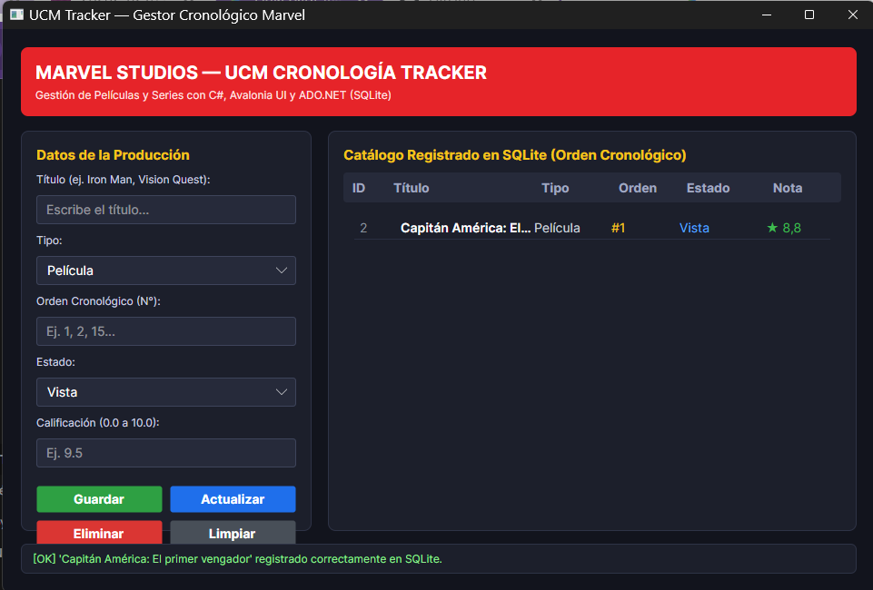
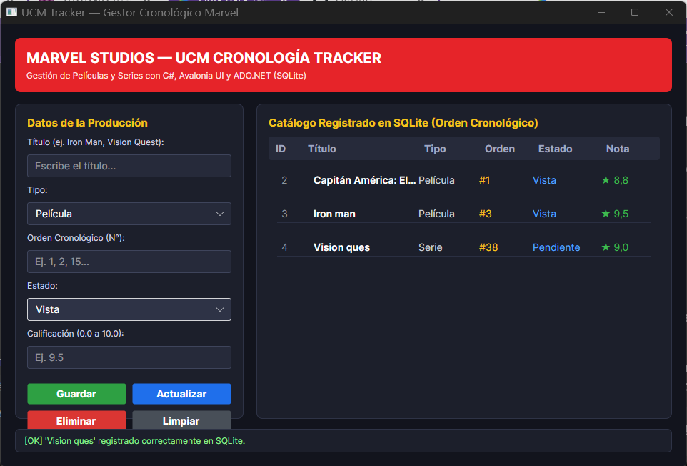
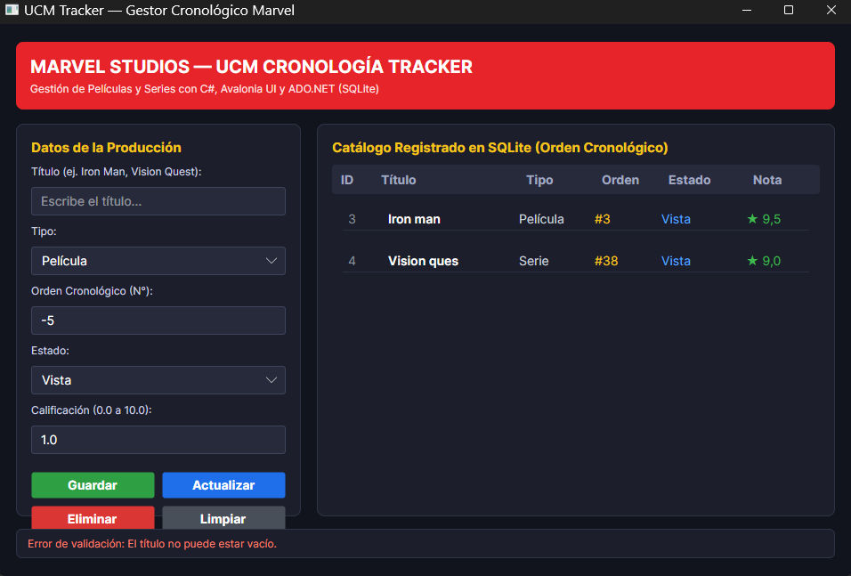
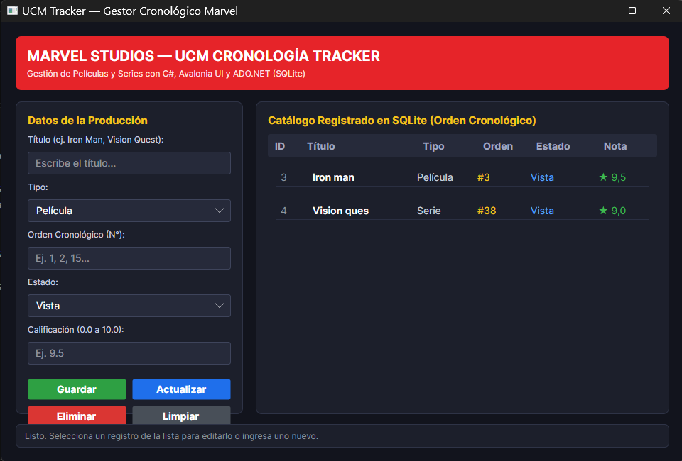

# UCM Tracker — Gestor Cronológico de Películas y Series Marvel

## 6.1. Información general
- **Nombre del proyecto:** UCM Tracker (Gestor Cronológico Marvel)
- **Estudiante:** Saray Natalia Duarte Florez
- **Modalidad:** Individual
- **Asignatura:** Programación en C# con .NET (Parcial Final — Semana 13)
- **Institución:** Corporación Universitaria Americana
- **Descripción del software:** Desarrollé una aplicación de escritorio en C# (.NET 8) con interfaz gráfica en Avalonia UI 11 y almacenamiento persistente local mediante ADO.NET y SQLite. El sistema me permite administrar un catálogo personalizado de películas, series y especiales del Universo Cinematográfico de Marvel (UCM) organizados según su orden cronológico.
- **Problema o necesidad que resuelve:** Como seguidora de las producciones de Marvel, necesitaba una herramienta local que me permitiera llevar un control ordenado y persistente de la línea temporal del UCM, registrando qué películas o series ya vi, cuáles tengo pendientes y qué calificación le asigno a cada una sin depender de listas externas.
- **Objetivo principal de la aplicación:** Implementar un sistema CRUD completo (Crear, Consultar, Actualizar y Eliminar) integrando Programación Orientada a Objetos (POO), interfaz gráfica XAML en Avalonia UI y consultas SQL parametrizadas con ADO.NET sobre SQLite.

---

## 6.2. Funcionalidades
- **Registro (Create):** Implementé un formulario que permite agregar nuevas producciones Marvel indicando título, tipo (Película, Serie o Especial), número en el orden cronológico, estado de visualización (Vista, En progreso o Pendiente) y calificación de 0.0 a 10.0.
- **Consulta (Read):** Configuré la vista principal para listar automáticamente todos los registros almacenados en SQLite ordenados de forma ascendente por su número cronológico (`ORDER BY OrdenCronologico ASC`).
- **Actualización (Update):** Al seleccionar cualquier fila del catálogo, la aplicación carga sus datos en el formulario para que pueda modificar su estado, nota o título y actualizar el registro directamente en la base de datos.
- **Eliminación (Delete):** Agregué la opción de eliminar permanentemente un registro seleccionado de la base de datos SQLite y refrescar el listado al instante.
- **Validaciones de entrada:** Programé validaciones antes de guardar o actualizar para verificar que el título no esté vacío, que el orden cronológico sea un entero positivo mayor a 0 y que la calificación esté dentro del rango válido (`0.0` a `10.0`), mostrando mensajes claros en pantalla.

---

## 6.3. Tecnologías utilizadas
- **Versión de .NET:** .NET 8.0 SDK
- **Lenguaje de programación:** C# 12
- **Interfaz gráfica:** Avalonia UI 11 (`.axaml`)
- **Acceso a datos:** ADO.NET (`Microsoft.Data.Sqlite` versión `8.0.11`)
- **Motor de base de datos:** SQLite 3 (archivo local `ucm_tracker.db`)
- **Entorno de desarrollo:** Visual Studio Code y Git / GitHub

---

## 6.4. Estructura del proyecto

```text
UcmTrackerApp/
├── Data/
│   └── MarvelRepository.cs      # Clase de acceso a datos con ADO.NET y SQLite (CRUD)
├── Models/
│   └── ProduccionMarvel.cs      # Clase modelo que representa la entidad del dominio
├── evidencias/
│   ├── registro.png             # Captura de prueba 1: Registro
│   ├── consulta.png             # Captura de prueba 2: Consulta
│   ├── actualizacion.png        # Captura de prueba 3: Actualización
│   ├── eliminacion.png          # Captura de prueba 4: Eliminación
│   ├── validacion.png           # Captura de prueba 5: Validación
│   └── persistencia.png         # Captura de prueba 6: Persistencia
├── App.axaml                    # Configuración global de estilos y temas de Avalonia
├── App.axaml.cs                 # Ciclo de vida de la aplicación Avalonia
├── MainWindow.axaml             # Diseño visual de la ventana principal en XAML
├── MainWindow.axaml.cs          # Controlador de eventos de UI, validaciones e integración
├── Program.cs                   # Punto de entrada principal de la aplicación
├── UcmTrackerApp.csproj         # Archivo de proyecto .NET 8 y dependencias NuGet
└── README.md                    # Documentación técnica del proyecto
```

### Clases principales y aplicación de POO
1. **`ProduccionMarvel` (`Models/ProduccionMarvel.cs`):** Diseñé esta clase modelo para encapsular los atributos de cada producción (`Id`, `Titulo`, `Tipo`, `OrdenCronologico`, `Estado`, `Calificacion`) mediante propiedades públicas y sobrecarga de constructores (un constructor vacío y uno parametrizado).
2. **`MarvelRepository` (`Data/MarvelRepository.cs`):** Apliqué el principio de responsabilidad única separando por completo la lógica SQL de la interfaz gráfica. Encapsulé la cadena de conexión (`private readonly string _connectionString`) y expuse métodos públicos para las operaciones `Agregar`, `ObtenerTodas`, `Actualizar` y `Eliminar`.
3. **`MainWindow` (`MainWindow.axaml.cs`):** En esta clase gestiono la interacción con el usuario, capturo los eventos `Click` y `SelectionChanged`, ejecuto las validaciones de entrada y delego las operaciones de persistencia a mi instancia de `MarvelRepository`.

---

## 6.5. Instalación de dependencias
1. Verificar que esté instalado el **SDK de .NET 8.0** ejecutando `dotnet --version`.
2. Clonar mi repositorio desde GitHub:
   ```bash
   git clone [https://github.com/saryduarte/ucm-tracker-avalonia.git](https://github.com/saryduarte/ucm-tracker-avalonia.git)
   ```
3. Ingresar a la carpeta del proyecto:
   ```bash
   cd ucm-tracker-avalonia
   ```
4. Restaurar los paquetes NuGet necesarios (incluye `Avalonia` y `Microsoft.Data.Sqlite` 8.0.11):
   ```bash
   dotnet restore
   ```
*(No requiere configuración de servidores externos ni scripts SQL manuales, ya que la aplicación genera la base de datos SQLite automáticamente al iniciar).*

---

## 6.6. Ejecución del programa
1. Compilar el proyecto para comprobar que no existan errores:
   ```bash
   dotnet build
   ```
2. Ejecutar la aplicación de escritorio:
   ```bash
   dotnet run
   ```
Al ejecutarse, se despliega la ventana principal **UCM Tracker — Gestor Cronológico Marvel** lista para registrar, consultar, actualizar o eliminar producciones.

---

## 6.7. Base de datos
- **Información almacenada:** La aplicación guarda los registros en la tabla `ProduccionesMarvel` con las siguientes columnas:
  - `Id` (`INTEGER PRIMARY KEY AUTOINCREMENT`): Identificador único autoincremental de cada registro.
  - `Titulo` (`TEXT NOT NULL`): Nombre de la película, serie o especial.
  - `Tipo` (`TEXT NOT NULL`): Clasificación del formato (`Película`, `Serie`, `Especial`).
  - `OrdenCronologico` (`INTEGER NOT NULL`): Posición dentro de la línea temporal del UCM.
  - `Estado` (`TEXT NOT NULL`): Seguimiento de visualización (`Vista`, `En progreso`, `Pendiente`).
  - `Calificacion` (`REAL NOT NULL`): Puntuación numérica asignada (`0.0` a `10.0`).
- **Conexión con SQLite:** La establezco mediante `SqliteConnection` usando la cadena `"Data Source=ucm_tracker.db"` dentro de bloques `using` para asegurar el cierre de la conexión y liberación de recursos después de cada operación.
- **Operaciones CRUD:** Las ejecuto mediante `SqliteCommand` empleando consultas parametrizadas (`@Titulo`, `@Tipo`, `@OrdenCronologico`, `@Estado`, `@Calificacion`, `@Id`) para evitar inyección SQL, usando `ExecuteNonQuery()` para inserciones, actualizaciones y eliminaciones, y `SqliteDataReader` (`ExecuteReader()`) para la consulta de registros.
- **Creación automática:** Al instanciar `MarvelRepository`, el método privado `InicializarBaseDeDatos()` crea automáticamente el archivo `ucm_tracker.db` y ejecuta `CREATE TABLE IF NOT EXISTS ProduccionesMarvel (...)` si la tabla aún no existe.

---

## 6.8. Evidencias de funcionamiento

### 1. Prueba de Registro (Create)
Ingresé la película *Capitán América: El primer vengador* (Orden #1, Vista, Nota 8.8) y presioné **Guardar**. El sistema confirmó la inserción en SQLite y la mostró en la tabla.


### 2. Prueba de Consulta (Read)
Registré varias producciones (*Capitán América*, *Iron Man* y *Vision Quest*) y comprobé que la aplicación consulta la base de datos y las ordena automáticamente por su número cronológico (`#1`, `#3`, `#38`).


### 3. Prueba de Actualización (Update)
Seleccioné el registro ID #4 (*Vision Quest*), cambié su estado de `Pendiente` a `Vista` y presioné **Actualizar**, reflejando el cambio de inmediato en la tabla y en SQLite.


### 4. Prueba de Eliminación (Delete)
Seleccioné el registro *Capitán América: El primer vengador* de la lista y presioné **Eliminar**, verificando que se removiera de la base de datos y desapareciera del catálogo.


### 5. Prueba de Validación de datos
Intenté guardar un registro dejando el campo **Título** vacío y escribiendo un número inválido (`-5`) en el orden cronológico; la aplicación bloqueó el registro y mostró el mensaje de error en rojo en la barra inferior.


### 6. Prueba de Persistencia de datos
Cerré por completo la ventana de la aplicación y volví a ejecutarla con `dotnet run`, comprobando que los registros guardados previamente (*Iron Man* y *Vision Quest*) seguían almacenados en `ucm_tracker.db`.


---

## 6.9. Problemas encontrados y soluciones
1. **Incompatibilidad de versión del SDK de .NET al crear la plantilla:** Cuando ejecuté `dotnet new avalonia.app`, la plantilla creó el proyecto apuntando a `net9.0`, mientras que en mi equipo tengo instalado `.NET 8.0 SDK`, lo que generó el error `NETSDK1045`. **Solución:** Cambié `<TargetFramework>net8.0</TargetFramework>` dentro de `UcmTrackerApp.csproj`, logrando restaurar `Microsoft.Data.Sqlite` 8.0.11 y compilar correctamente.
2. **Contraste de texto en los controles de entrada con tema oscuro:** Al principio, cuando escribía o pasaba el cursor sobre los `TextBox`, el tema claro por defecto cambiaba el fondo a blanco manteniendo la letra blanca. **Solución:** Agregué `RequestedThemeVariant="Dark"` en `MainWindow.axaml` y definí estilos explícitos (`Window.Styles`) para los estados `:pointerover` y `:focus` de `TextBox` y `ComboBox`.
3. **Separador decimal en las calificaciones:** Según la configuración regional de Windows, podía ingresar calificaciones con punto (`9.5`) o con coma (`9,5`). **Solución:** Normalicé el texto reemplazando `,` por `.` antes de convertirlo con `double.TryParse` usando `CultureInfo.InvariantCulture`.
